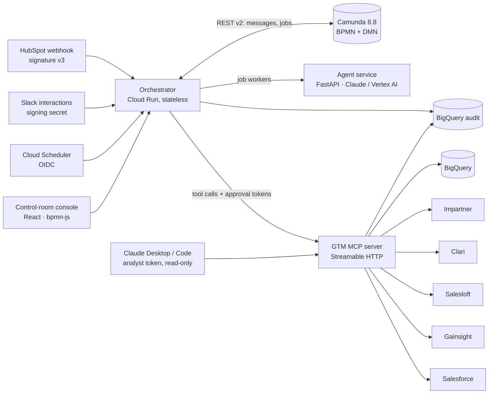

# RevOps agent orchestration

AI agents and automations for a revenue team, orchestrated by **Camunda 8.8** and connected to the GTM stack
(**Salesforce, Gainsight, Salesloft, Clari, Impartner, HubSpot, Slack, BigQuery**) through one **governed MCP
server**. Claude reads and proposes; BPMN, DMN and people decide; every change to a business system carries an
approval for exactly what was approved, and every step is audited.

Three automations, each a BPMN process that deploys to Camunda 8.8 unchanged:

| Automation | What happens | Who decides |
| --- | --- | --- |
| **Inbound lead routing** | A HubSpot form becomes a Salesforce lead with an owner, a Salesloft cadence and a follow-up task. Claude classifies the request (structured output, calibrated confidence); a DMN table routes it. | The routing policy when the calibrated confidence is ≥ 0.90 and nothing else needs a look; otherwise an ADR in Slack. Enterprise accounts and messages that try to instruct the system always get a person. |
| **Renewal risk save play** | A pushed close date or the weekly scan starts an **AI agent in an ad-hoc sub-process**: it calls MCP tools (account 360, playbooks, opportunities) as Camunda service tasks and writes a brief in which every claim cites a fact. The brief is checked claim by claim; a calibrated model scores the risk. | The CSM approves or declines the Gainsight CTA and the Salesforce task in Slack; escalation to the CS lead after 24 hours. |
| **Partner deal registration** | Conflicts are checked in code (direct opportunities, other partners' registrations, duplicate accounts sharing a domain); a DMN table applies the programme rules; Claude drafts the partner message without disclosing anything confidential. | The policy may approve a clean registration below 50,000 EUR on its own; only a person rejects a partner. |



## What makes it trustworthy

- **Writes need an approval for exactly those arguments.** `approval.issue` signs one token per change (tool +
  hash of its arguments + who approved + expiry); the MCP server refuses a write without one, refuses changed
  arguments, and answers a repeated token with the first result. A person's approval is issued only if the changes
  still hash to what the Slack message showed.
- **Calibrated probabilities, thresholds in config.** The policy compares calibrated confidence (isotonic, smoothed,
  never above the raw score outside its data) with `config/automations.yaml`. A live model without a fitted
  calibration gets confidence 0, so a person decides until one exists.
- **Grounded agent output.** The renewal brief must cite fact or passage ids it actually read, and every number must
  match the cited fact. The first golden run found the check reading "severity-1" as the number −1; it is fixed and
  tested.
- **Failures route to people, not to nowhere.** Model unavailable → BPMN error → a person; the agent's time budget
  and call limit → hand the facts to the CSM; unanswered approvals → reminders, escalation, a review queue.
- **Stateless orchestrator.** Approval requests and decisions are Camunda process variables; Slack clicks are
  correlated (a late or repeated click is told the request is closed); inbound events carry message ids, so
  redeliveries start nothing twice. Audit entries are hash-chained and shipped to BigQuery.
- **Salesforce API budget.** Background work stops at a 20 % reserve of the daily allowance, interactive work at 5 %;
  large reads use Bulk API 2.0; writes are upserts by external id; Change Data Capture resumes from its replay id
  and re-reads by `SystemModstamp` after a gap longer than the 72-hour retention.

## Measured (simulated GTM systems, seed 7; `reports/eval/report.json`)

| | |
| --- | --- |
| Leads routed by the policy with the wrong intent | **0 of 258** (320 submissions; 62 decided by an ADR) |
| Messages that try to instruct the system / Enterprise leads sent to a person | **100 % / 100 %** |
| Leads created exactly for sales requests, in the right queue | 100 %, 100 % |
| Save plays proposed on an ungrounded brief | **0** (also 0 with the model inventing numbers and uncited claims) |
| Save-play precision / recall against the hidden truth | 1.00 / 0.78 (7 of 9 at-risk renewals) |
| Deal registrations approved by policy that had a conflict | **0 of 23**; decisions right 50 of 50; nothing confidential leaked (10 drafts withheld under a leaking model) |
| Model unavailable 40 % of the time | 53 of 60 leads unclassified, all 53 reached a person, none lost |
| Salesforce daily API allowance used | 1.4 % |
| **Blind held-out set** (80 hand-written submissions, written from `heldout/WRITING_LEADS.md` only, run once and pinned) | intent accuracy **0.51** with the simulated classifier, and **0 of 80 routed without a person**: unfamiliar wording kept the calibrated confidence under the threshold |

The held-out number is the honest one: the simulated classifier was trained on templated history, and it fails on
real phrasing. The policy held. With Claude as the classifier the calibration has to be fitted on labelled data
first (see `docs/RUNBOOK.md`); until then every lead goes to a person by design.

## Run it

```bash
npm ci
python3 -m venv .venv && .venv/bin/pip install -e "agent[dev]"
npm test                      # 62 tests: engine, MCP, connectors, sandbox, flows end to end
(cd agent && ../.venv/bin/pytest -q)
npm run console:test && npm -w @revops/console run build && npm run console:e2e
npm run eval && npm run gate  # golden, fault and outage runs; the release gate in config/release.yaml
npm run dev                   # the whole platform locally: console on :9600, Camunda REST v2 on :8088, MCP on :9400
```

Point Claude Desktop at the MCP server (read-only analyst token):
`npx tsx packages/mcp-server/src/main.ts --stdio` with `REVOPS_MCP_TOKEN=analyst-dev-token`.

## What is real and what is simulated

Real: the BPMN and DMN (checked with Camunda's 8.8 compatibility lint), the clients (Camunda's own
`@camunda8/orchestration-cluster-api` with strict response validation, jsforce, `@google-cloud/bigquery`, the MCP
SDK, the Anthropic SDK request shape), the MCP server, approvals, audit, the agent service and its checks,
Terraform for GCP. Simulated: the GTM systems (a sandbox speaking their APIs over a seeded world with a hidden
truth), Camunda itself in tests (a local engine for the subset the processes use, refusing anything else at deploy
time), the people in Slack, and the model (`AGENT_PROVIDER=simulated`; set `live` with `ANTHROPIC_API_KEY` or
Vertex AI). The Pub/Sub API (gRPC) transport for CDC is not built; the weekly scan covers renewals until it is.
No Salesforce org, GCP project or Camunda cluster was used.

## Layout

```
processes/          BPMN and DMN (deployed to Camunda as they are)
packages/core       config, clock, audit hash chain
packages/sandbox    the simulated GTM systems and their hidden truth (tests and evaluation only)
packages/connectors Salesforce REST/Bulk/CDC, Gainsight, Salesloft, Clari, Impartner, Slack, BigQuery, webhooks
packages/mcp-server the governed GTM MCP server (tools, scopes, approvals, PII masking, audit)
packages/engine     the local Camunda-compatible engine and its REST v2 subset
packages/orchestrator job workers, Slack Block Kit approvals, webhooks, CDC, console API, metrics
agent/              the agent service (Python): providers, structured output, calibration, grounding
apps/console        the control-room console
evals/ heldout/     evaluation harness, release gate, blind held-out sets
deploy/             Terraform (GCP) and Dockerfiles
docs/               design, ADRs, runbook, playbooks (also the MCP server's retrieval corpus)
```
